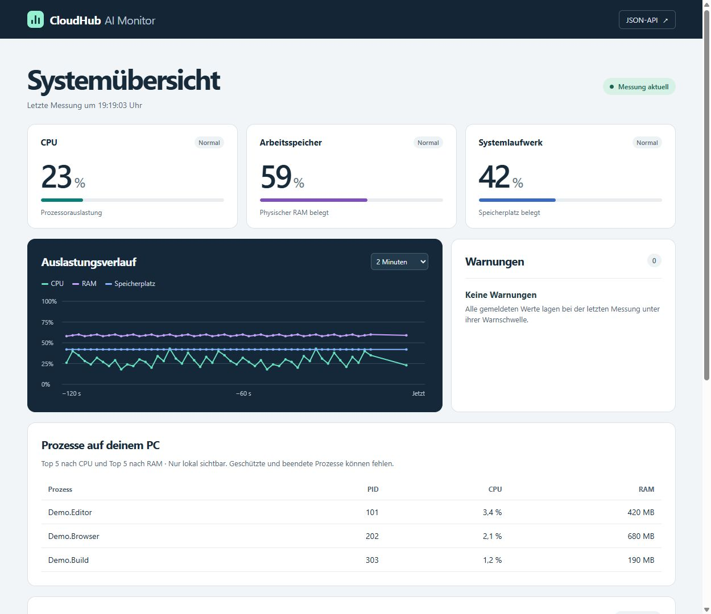
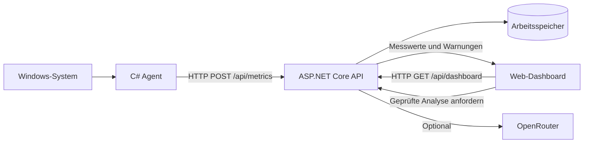

# CloudHub AI Monitor

Windows-Monitoring mit C#, ASP.NET Core und einem lokalen Web-Dashboard. Ein Agent erfasst die Auslastung des Rechners. Das Backend nimmt die Messwerte über eine REST-API entgegen, prüft Warnschwellen und zeigt den Verlauf im Browser.

Der optionale PC-Assistent fasst eine Minute Messdaten zusammen. Vor einer Analyse mit OpenRouter lässt sich die vollständige Anfrage prüfen.



*Die Abbildung verwendet ausschließlich fiktive Messwerte, Prozessnamen und Prozess-IDs.*

## Funktionen

- CPU-Auslastung, RAM-Belegung und belegter Speicherplatz des Windows-Systemlaufwerks.
- Prozessübersicht mit den jeweils fünf größten Verbrauchern nach CPU und RAM.
- Dashboard mit automatischer Aktualisierung, kurzem Verlauf und Warnungen.
- 60-Sekunden-PC-Check mit Fragefeld, Datenvorschau und optionaler KI-Analyse.
- Vergleich der Durchschnittswerte zweier Checks innerhalb einer Browsersitzung.

## Architektur



Agent und Backend laufen als getrennte Prozesse. Das Dashboard wird von derselben API ausgeliefert und benötigt keinen eigenen JavaScript-Build. Das Backend kann für Docker gebaut werden, während der Agent weiterhin auf Windows misst.

## Lokal starten

Voraussetzungen sind Windows für den Agenten, das [.NET-10-SDK](https://dotnet.microsoft.com/download/dotnet/10.0) und PowerShell. Die Befehle werden im Projektordner ausgeführt.

Im ersten Terminal die API starten.

```powershell
dotnet build
dotnet run --project .\src\CloudHub.Api -- --urls http://127.0.0.1:5081
```

Im zweiten Terminal den Agenten starten und das Fenster geöffnet lassen.

```powershell
.\scripts\Start-Agent.ps1 -Port 5081
```

Das Dashboard ist unter [http://127.0.0.1:5081](http://127.0.0.1:5081) erreichbar. Nach der ersten Messung erscheinen die Werte. Mit `Strg+C` lässt sich der jeweilige Prozess beenden.

## API ausprobieren

| Methode | Pfad | Aufgabe |
| --- | --- | --- |
| GET | `/health` | Erreichbarkeit prüfen |
| POST | `/api/metrics` | Messung validieren und übernehmen |
| GET | `/api/metrics/latest` | Letzte gültige Messung abrufen |
| GET | `/api/dashboard` | Verlauf und Warnungen abrufen |
| POST | `/api/checks` | PC-Check beginnen |
| POST | `/api/checks/{id}/preview` | Diagnosevorschau erstellen |
| POST | `/api/checks/{id}/analyze` | Geprüfte Vorschau an OpenRouter senden |

Der Datenfluss lässt sich mit fiktiven Werten testen. Pausiere dafür den Agenten, damit er den Testwert nicht sofort ersetzt.

```powershell
Invoke-RestMethod -Method Post -Uri 'http://127.0.0.1:5081/api/metrics' -ContentType 'application/json' -Body '{"cpuPercent":25,"ramPercent":85,"diskUsedPercent":42}'
Invoke-RestMethod 'http://127.0.0.1:5081/api/metrics/latest'
```

Bei RAM ≥ 85 % erscheint eine Warnung. Für CPU und belegten Speicherplatz liegt die Schwelle jeweils bei 90 %. Ungültige Prozentwerte führen zu `400 Bad Request`. Vor der ersten Messung liefert `/api/metrics/latest` den Status `404`.

## Optionaler PC-Assistent

Das Monitoring funktioniert ohne OpenRouter-Key. Für die Analyse lässt sich ein Schlüssel lokal einrichten.

```powershell
.\scripts\Set-OpenRouter.ps1
```

Das Skript fragt den Schlüssel verdeckt ab und speichert ihn in `src/CloudHub.Api/appsettings.Local.json`. Anschließend die API neu starten. Die Datei ist durch Git ausgeschlossen und wird beim Publish ausgelassen. Alternativ unterstützt das Backend `OPENROUTER_API_KEY` oder `OpenRouter__ApiKey` als Umgebungsvariable.

Im Dashboard eine Frage eingeben, ein kostenloses Modell auswählen und den 60-Sekunden-Check starten. Der Agent muss währenddessen laufen. Danach zeigt die Vorschau genau die Anfrage, die durch den Analyse-Button versendet wird.

Prozessnamen und PIDs werden für diese Anfrage durch Aliase ersetzt. Die Zuordnung bleibt lokal sichtbar. **Der selbst eingegebene Fragetext wird vollständig übertragen.** Persönliche Angaben sollten vor der Vorschau entfernt werden.

Vorausgewählt ist `recursive/flint-v1.0:free`. Dieses Modell lieferte im Funktionstest mit fiktiven Daten eine vollständige Antwort bei gemeldeten Kosten von 0. Der Test erforderte deaktiviertes Zero Data Retention. Der ZDR-Haken ist zunächst aktiviert und kann vor der Messung bewusst entfernt werden.

`data_collection: deny` bleibt auch ohne ZDR aktiv. Die Anbieterbedingungen und Kontoeinstellungen gelten weiterhin. Die Anwendung erlaubt ausschließlich die aufgeführten kostenlosen Modelle und fordert Preisobergrenzen von 0 an. Nutzungslimits, regionale Einschränkungen oder Datenschutzvorgaben können einen Aufruf verhindern. [OpenRouter-Anbieterwahl](https://openrouter.ai/docs/guides/routing/provider-selection)

Flint benötigt Budget für interne Verarbeitung und sichtbare Antwort. Die Anfrage erlaubt insgesamt 8192 Tokens und bis zu 120 Sekunden Bearbeitungszeit. Nach einem Anbieterfehler kann dieselbe Vorschau erneut gesendet werden. Nach Erfolg ist sie verbraucht. Änderungen an Frage, Modell oder Datenschutz erfordern einen neuen Check.

## Daten und Sicherheit

- Messwerte, Prozessdaten und Analysevorschauen liegen im Arbeitsspeicher. Es gibt keine Datenbank oder automatischen Diagnoseexporte.
- Der Verlauf umfasst bis zu zwei Minuten und maximal 120 Messpunkte. Checks verfallen nach zehn Minuten.
- Lokale Schlüsseldateien, Logs und Exportordner werden von Git ausgeschlossen. Der Docker-Build erhält ausschließlich die freigegebenen Quelldateien.
- Persönliche Exporte gehören nach `local/`, `metrics/`, `measurements/` oder `exports/`. Persönliche Bildschirmfotos gehören nach `screenshots/`.
- Die API enthält keine Benutzeranmeldung. Die dokumentierten Startbefehle binden sie an die Loopback-Adresse. Vor einer Bereitstellung über das Internet sind Authentifizierung und weitere Zugriffskontrollen erforderlich.

Vor einem Commit lassen sich die vorgemerkten Inhalte und Ausschlussregeln prüfen.

```powershell
git diff --cached
git check-ignore -v -- src/CloudHub.Api/appsettings.Local.json metrics/latest.json screenshots/dashboard.png
```

Git-Ausschlussregeln prüfen Dateipfade. Bereits versionierte Dateien und sensible Inhalte in Quellcode benötigen eine gesonderte Prüfung.

## Tests

```powershell
dotnet build --configuration Release
dotnet run --project .\tests\CloudHub.Checks.Smoke --configuration Release
```

Der Integrationstest verwendet eine simulierte Uhr und einen simulierten OpenRouter-Handler. Er prüft Messfenster, Datenlücken, Anonymisierung, Datenvorschau, kostenlose Preisgrenzen, Datenschutzwahl, Wiederholung nach Fehlern, Tokenlimit und abgelaufene Checks. Ein echter Schlüssel oder eine externe Anfrage wird dafür nicht benötigt.

## Docker

Das Dockerfile baut die API in einem SDK-Image und übernimmt die veröffentlichten Dateien in ein ASP.NET-Laufzeitimage. Der Container läuft mit dem vorgesehenen Nicht-Root-Benutzer.

Zuerst die lokal gestartete API auf Port 5081 beenden. Anschließend mit laufender Docker Engine für Linux-Container ausführen.

```powershell
docker build -t cloudhub-api:local .
docker run --rm --name cloudhub-api -p 127.0.0.1:5081:8080 cloudhub-api:local
```

Der Windows-Agent kann weiterhin über `.\scripts\Start-Agent.ps1 -Port 5081` senden. Für optionale KI-Aufrufe kann der Container den Schlüssel zur Laufzeit als Umgebungsvariable erhalten. Ein bereits im Terminal gesetztes `OPENROUTER_API_KEY` wird mit `--env OPENROUTER_API_KEY` weitergegeben.

**Stand der Prüfung** — .NET-Build, Windows-Messung, lokale API, Dashboard und KI-Ablauf wurden getestet. Der Docker-Start wurde in der bisherigen Entwicklungsumgebung mangels Docker Engine noch nicht ausgeführt.

## Grenzen und nächste Schritte

CPU-Werte beruhen auf einem Messfenster und können von der Task-Manager-Anzeige abweichen. Prozess-RAM bezeichnet das Working Set. Gemeinsam genutzte Speicherseiten können in mehreren Prozessen enthalten sein. Geschützte oder beendete Prozesse können in der Übersicht fehlen.

Die Anwendung ist ein lokaler MVP. Nach einem Backend-Neustart beginnt die Messhistorie erneut. Eine KI-Antwort liefert mögliche Erklärungen; Anpassungen am Rechner werden manuell durchgeführt.

Als nächste Schritte sind ein vollständiger Docker-Funktionstest, persistente Messhistorie, GitHub Actions und eine lokale Kubernetes-Bereitstellung vorgesehen.
